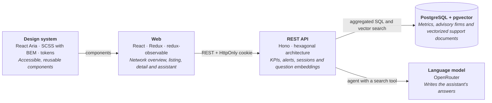

# Pulse by Maurice Domínguez

[](https://sonarcloud.io/summary/new_code?id=madoos_pulse)
[](https://sonarcloud.io/component_measures?id=madoos_pulse&metric=coverage)
[](https://app.snyk.io/org/madoos/projects)
[](https://sentry.io/projects/)

## Run it locally

The only requirement is Docker. From the root of the repository:

```bash
docker compose up --build
```

The application runs at http://localhost:8080. The support assistant needs `OPEN_ROUTER_API_KEY=...` in a `.env` file at the root; without it, the assistant shows as unavailable and everything else works the same.

## Deployed

This project is continuously deployed to Kubernetes: every release is built and rolled out automatically.

| Service | URL |
| --- | --- |
| Application | https://pulse.0t4da4u.cserverhost.cloud |
| API docs | https://pulse.0t4da4u.cserverhost.cloud/api/v1/docs |
| Design system | https://storybook.0t4da4u.cserverhost.cloud |
| Database (read-only) | https://pgweb.0t4da4u.cserverhost.cloud |

Wherever a login is asked for, use the user `admin@pulse.com` and the password `pulse-demo-password`. They are the same locally.

## How it was built

This project was designed to deliver value from minute one and iterate fast. Instead of building the whole backend first and then the whole frontend, each feature was built end to end, through every layer, and deployed as soon as it was ready:

| Order | Delivery | What it brings |
| :---: | --- | --- |
| 1 | Continuous delivery | Database, API, web, CI and deployment connected from day one: the product is live and every change reaches production. |
| 2 | Network overview | How the network is doing as a whole and which advisory firms need attention. |
| 3 | Listing | Find any advisory firm with search and filters. |
| 4 | Detail | How each advisory firm evolves, and how it compares with its specialty. |
| 5 | Support assistant | Ask the documents of each advisory firm. |

The same way of working splits the system into independent pieces: a design system, a web application and a REST API, with the shared contracts in their own package. The idea is to grow horizontally: the design system, the contracts and the API can be shared with other projects, not just this one.

It is set up as a real project: token-based authentication, vulnerability scanning, quality gate, error monitoring in production, continuous integration, infrastructure as code, and automated releases from Conventional Commits that generate the changelog and the Docker images of each version.



## KPIs

Analysing the data, revenue grows in direct relation to clients: that is why the KPIs follow that logic, how many clients there are, how many leave and how much each one brings in. And the same KPIs that measure an advisory firm measure the whole network, with the same rules, so what is learned in one view applies to the other.

| Section | KPI | Why |
| --- | --- | --- |
| **Network and firm** | Active clients | Is it growing in clients? Those of the last month of the period, so the same client is never counted twice. |
| | Revenue | Does it bill more or less? Sum of advisory, management and consulting. |
| | Revenue per client | Tells growing in clients apart from growing in value. |
| | Monthly churn | The earliest sign that something is wrong. As a percentage, it compares firms of any size. |
| **Firm only** | Tax filings | Does it file many returns? |
| | Tax agency incidents | Filing a lot is not filing well: out of every 100 filings, how many end in an incident. |
| | Revenue per employee | How much each person bills: compares firms of different sizes. |
| **Comparison** | Same months of another year | April with April: seasonality never looks like growth or decline. |
| | Against its specialty | It shares its fiscal calendar: the gap is the firm's merit or problem. Answers "does it bill more than six months ago?" without the seasonality trap. |
| **Who does best and worst** | Standouts | The 4 that grow most in active clients against the previous year: a model for the rest of the network. |
| | Needs attention | Those that fail some KPI against the previous year or the network: losing clients, 1.5 times the network's churn, billing less, or losing 10% of value per client. The thresholds are relative, so they do not go stale as the network grows. |
| **Filters** | Fiscal year, April to March | The data starts in April: each year is complete and compared with another complete one. |
| | Months (from and to) | Look at part of the year only, such as the income tax campaign. The compared year uses the same months. |
| | Compare with another year | See whether a period does better or worse than the same period of another year. |
| | Group by specialty or autonomous community | Find which part of the network pulls the whole up or down. Network only: a single firm has nothing to group. |
| | Type of alert | Go straight to a specific problem among the firms that need attention. |
| | Province, specialty and name (listing) | Find a specific advisory firm. |

## What it includes

### Phase 1

| Requirement | | How |
| --- | :---: | --- |
| Database with reproducible migrations | ✅ | PostgreSQL and Drizzle. The CSV files are loaded as versioned seeds with the migrations, and the support documents with their embeddings already computed with the `multilingual-e5-small` model. |
| API | ✅ | Hono, hexagonal modular monolith, contracts with zod and OpenAPI. |
| Listing with filters | ✅ | Search by name, filters by province and specialty, paged loading. |
| Advisory firm detail | ✅ | Profile, alerts, month-by-month indicators, and comparison with another year, with its specialty and with six months earlier. |
| Network overview | ✅ | Month-by-month indicators, year comparison, breakdown by group, firms that need attention and firms that stand out. |
| `docker compose up` with no manual steps | ✅ | Starts the whole system. |
| Unit and integration tests | ✅ | Unit tests in every package, integration tests against a real PostgreSQL, and end-to-end acceptance tests. |
| CI/CD | ✅ | Lint, tests, quality gate, dependency and image scanning, image builds and continuous deployment. |
| Bonus: infrastructure as code | ✅ | Kubernetes manifests with Kustomize in [`deploy/k8s/`](deploy/k8s/), applied on every release. |

### Phase 2: assisted support

| Requirement | | How |
| --- | :---: | --- |
| Index the support information | ✅ | Embeddings in PostgreSQL with pgvector. |
| Ask from an advisory firm's page | ✅ | Assistant in the detail page, with suggested questions. |
| Answer with its sources | ✅ | Cites the id, type, date and title of each document, read from the database. |
| No mixing between firms | ✅ | The firm is set by the code and filters every search in SQL. |
| Say when there is not enough information | ✅ | If no document is similar enough, it says so without calling the model. |

## Technical decisions

Every technical decision is recorded in the [ADRs](docs/adr/README.md), each with its context, alternatives and consequences. The [design log](docs/bitacora.md) (in Spanish) shows how the project was built and the reasoning behind each step.

### Phase 1 questions

#### 1. What did you leave out for lack of time?

| What | Why it matters | How I would approach it |
| --- | --- | --- |
| Real ingestion and normalization | The source data had errors, such as negative VAT or repeated months, that distort the metrics of a period. I cleaned them by hand (see below). | An ingestion process that validates, normalizes and corrects or discards those records before loading them. |
| Materialized views | Almost every query is a sum, average or grouping over data that does not change. | Precompute them in materialized views, refreshed when each month's data arrives. |
| Acceptance tests for the assistant | The model is not deterministic and depends on an external platform with costs. | A fake model for the end-to-end scenario, and separate evaluations with a fixed set of questions. |
| Better semantic search | Accuracy depends on how the documents are described, and there is no way to know whether the answers help. | Categorize and tag the documents before indexing them, and measure when users mark an answer as valid. |

#### 2. Which part is the most fragile or the least efficient?

| What | Problem | First step |
| --- | --- | --- |
| Free model | Its quota runs out, and each question may be answered by a different model. | A fixed paid model: it is configuration. |
| Embeddings inside the API | Each question takes about 50 ms of CPU, and each replica about 480 MB of memory. | A dedicated embedding service that scales on its own. |
| A single node | If the VPS goes down, everything goes down. | Backups outside the VPS and a managed database. |

#### 3. What would you change with 5,000 advisory firms?

| | Today | With 5,000 |
| --- | --- | --- |
| Metrics (3 years) | 50 × 36 months = 1,800 rows | 5,000 × 36 months = 180,000 rows |
| Support documents | 330 | about 33,000 |

| Part | Scales? | Why |
| --- | :---: | --- |
| Network indicators | ✅ | One row per firm and month, indexed by period, and one aggregated query per section: 180,000 rows take milliseconds. |
| Listing | ✅ | Pages by cursor and only renders the visible rows. |
| Detail | 🟡 | Computes the alerts of the whole network to use those of one firm. Asking for the network average and that firm's totals would be enough. |
| Semantic search | ❌ | The bottleneck. Accuracy depends on the embedding model, which must be the same for documents and questions: changing it means recomputing everything. |
| Question embeddings | ❌ | Computed in the API, so its CPU and memory are the first to run out. |
| OpenRouter model | ❌ | Depends on its free tier: with more users, the assistant would often be unavailable. |

### Phase 2 questions

#### 4. How do you guarantee isolation between firms? What about 10,000 documents?

| Layer | How it is isolated |
| --- | --- |
| Input | The firm comes from the URL; the model never decides it. |
| Search | Every search filters by firm in SQL, and the agent's tool has no firm parameter. |
| Sources | The code drops any source that the searches of that firm did not return. |
| Tests | An integration test checks that a document of another firm never comes back. |

| With 10,000 documents | |
| --- | --- |
| Cost per question | Does not change: at most 10 documents and 4 searches. |
| What would be needed | An approximate vector index (HNSW) so the search does not scan them all, and maybe a reranker. |

#### 5. How do you handle traceability? What if a document is updated or deleted?

| Case | What happens |
| --- | --- |
| Every answer | Cites its sources with data from the database, not from the model's text. |
| Record | Stores the question with its vector, every search with what it found, the answer, the sources, the model and the tokens. |
| Updated document | Each document stores a hash of its content: if it changes, the ingestion recomputes its embedding and replaces it. |
| Deleted document | It can no longer be found or cited. |
| Limit | An old answer stores the ids of its sources, not their content. Next step: store their hash too, or version the documents. |

#### 6. What cost and complexity does it have? What external dependencies does it add?

| Dependency | Cost | Effect on deployment |
| --- | --- | --- |
| OpenRouter (free models) | Free, with a quota | A key in a Secret. Without a key or quota, the assistant says so and the rest works. |
| Local embedding model | Free, about 50 ms per question | Ships inside the API image: about 560 MB of image and 480 MB of memory. It needs glibc, so the image is distroless instead of Alpine. |
| pgvector | None | An extension of the same PostgreSQL, with no extra service. |

With real data, a paid model with a suitable data policy would be needed: free models may keep what they receive.

## Liberties taken

| Liberty | Why |
| --- | --- |
| Synthetic data for the two previous years | The CSV files have a single year (April 2025 to March 2026). I generated 2023-24 and 2024-25 to test the comparisons between years: without them, there is nothing to compare with. There are now 3 years, 1,800 rows of metrics. |
| Cleaned data | The CSV files had inconsistent data: a duplicated month with different amounts, negative VAT, a satisfaction of 6.2 out of 5, or more queries resolved than received. I cleaned and removed them before loading, acting as the ingestion layer: the application assumes the data arrives sanitized ([ADR-0013](docs/adr/0013-business-data-arrives-sanitized-from-ingestion.md)). |
| Login | The brief does not ask for it, but an internal tool with business data should not be open. There are users and sessions from the first deployment ([ADR-0011](docs/adr/0011-authentication-with-jwt-cookie-and-database-sessions.md)). |
